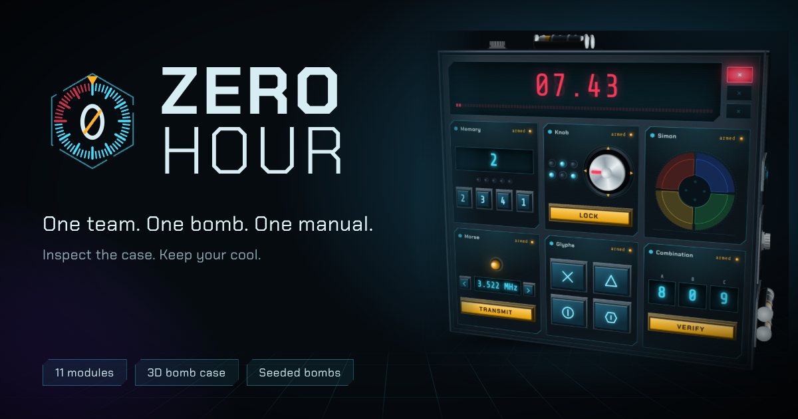

# Zero Hour

[](https://zero-hour.sunken.dev/)

**One team. One bomb. One manual.**

A cooperative bomb defusal game that runs in the browser. One of you inspects a 3D bomb case and defuses its modules; the
other reads the manual and cannot see the bomb. Describe what you see, find the rule, keep talking, keep your cool.

Live at **https://zero-hour.sunken.dev/**

- 25 modules, each rated easy, medium or hard, with a front and, for most, a rear plate on the back of the bomb
- needy modules that keep waking up and need attention until the bomb is defused
- choose a difficulty: modules of that rating come up more often, and the case shows it
- a module explorer to read about every module, try it, and switch modules or optional rear plates on and off
- an optional warning beep as the clock runs down
- a 3D case you turn with the mouse, with hints hidden on all sides
- seeds: the same seed with the same settings gives the same bomb
- a manual built from the same source as the game, also as a PDF
- synthesised sound and three adaptive music tracks that speed up as the clock runs down (no audio files)

The whole game is a single page, `site/index.html`, with no build step and no dependencies at run time.

## Try it

```sh
npm ci
npm run serve        # http://localhost:8080
```

Or just open `site/index.html` in a browser.

## Develop

```
site/                the published site (this folder is what gets deployed)
  index.html         the game, its manual and the embedded PDF manual
  zero-hour-manual.pdf, zero-hour-preview.png, icons, CNAME, robots.txt, sitemap.xml, ...
tools/               build scripts
tests/               tests (node:test)
.github/workflows/   CI and deployment
```

| Command | What it does |
| --- | --- |
| `npm test` | Runs all tests. The browser tests need Chrome: set `CHROME_PATH` to a Chrome or Chromium binary. |
| `npm run pdf` | Rebuilds `site/zero-hour-manual.pdf` from the manual's source. Needs Chrome and an internet connection (pdfmake comes from jsDelivr). |
| `npm run build` | Copies `site/` to `dist/` and rebuilds the PDF inside `dist/`. This is what gets published. |
| `npm run icons` | Redraws every favicon and app icon from the logo mark. |
| `npm run preview` | Re-renders the link-preview images (`-- --seed 1978` picks the bomb). |
| `npm run serve` | Serves `site/` on port 8080. |

### The manual and its PDF

The manual is generated from the modules' own text (`manual()` and `manualBack()` on each module), so it cannot drift from
the rules. Its PDF is made in the browser with [pdfmake](https://pdfmake.github.io/docs/): the page turns the manual into
plain data (`manualTree`), lays it out (`manualPdfDoc`) and has pdfmake write the PDF with the Chakra Petch fonts in
`site/fonts/`. pdfmake loads from jsDelivr at a pinned version, checked against its SHA-384 hash (`PDFMAKE` in
`index.html`); it is about 0.8 MB, and the fonts about 0.3 MB. When players switch modules off in the module explorer,
the manual and its PDF leave them out. Opened from disk, or when pdfmake cannot load, the buttons print the manual instead.

`site/zero-hour-manual.pdf`, the full manual, is made by the same code: `tools/build-manual-pdf.mjs` serves the page,
opens it in headless Chrome and asks it for the PDF. The same manual always gives the same file, and its revision (the
manual's fingerprint) is in the PDF's subject. After changing any rule or manual text, run `npm run pdf` before
committing. A test fails if you forget, and the deploy workflow rebuilds the PDF anyway.

### Adding a module

A module is one `Modules.register({ ... })` block in `site/index.html`: `id`, `title`, `difficulty`, `create(bomb, r)`,
`mount(root, state, ctl)` and `manual()`, plus optional `mountBack` and `manualBack` for a rear plate, `max` and `needs`. The
front and the rear plate get the same `state` object, so a rear plate can be a working part of the puzzle. The comment above the module
registry describes each field, and there is a template just before the "ADD YOUR OWN MODULE" comment. The module explorer
(the Modules button on the main screen) shows any module on its own, front and rear, with its description.

## Deploy to GitHub Pages on zero-hour.sunken.dev

1. Push this repository to GitHub (the default branch is `main`).
2. In the repository, open **Settings, Pages** and set **Source** to **GitHub Actions**.
3. In the same page set **Custom domain** to `zero-hour.sunken.dev`. The `site/CNAME` file already says so.
4. At the DNS provider for `sunken.dev` add a record:

   | Type | Name | Value |
   | --- | --- | --- |
   | `CNAME` | `zero-hour` | `<your-github-user-or-org>.github.io` |

5. When GitHub has issued the certificate, tick **Enforce HTTPS**.
6. Recommended: verify `sunken.dev` under your account's **Settings, Pages** so nobody else can claim a subdomain of it.

Every push to `main` then runs `.github/workflows/deploy.yml`: install, test, build, deploy. Pull requests and other branches run
`.github/workflows/ci.yml`, which tests and builds without publishing.

### Metadata

`site/index.html` carries the canonical address, Open Graph and Twitter card tags (with an absolute link to
`zero-hour-preview.png`, 1200 x 630), structured data (schema.org `VideoGame`), the icon set, the web manifest and the
theme colour. `robots.txt` and `sitemap.xml` name the domain. If the domain ever changes, search the repository for
`zero-hour.sunken.dev`: `site/CNAME`, `site/index.html`, `site/robots.txt`, `site/sitemap.xml`, `tools/` and the tests.

## Licence

None chosen yet. Add a `LICENSE` file before making the repository public.
